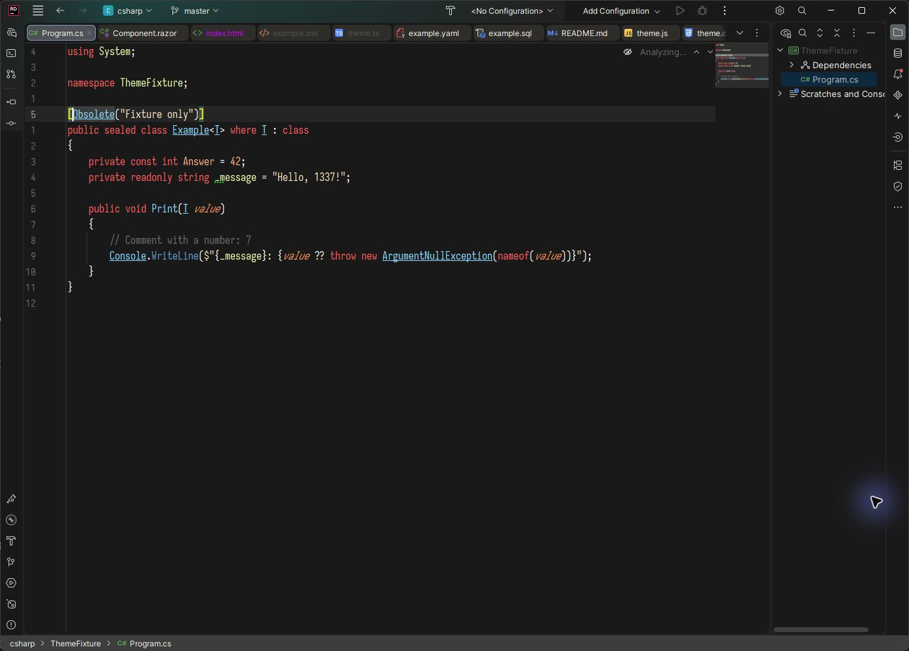

# 1337 Theme for IntelliJ Platform IDEs

1337 Theme is a dark theme and editor color scheme for IntelliJ Platform IDEs
on build 262 (2026.2) and later, based on Mark Herpich's original Sublime Text
[1337 Scheme](https://github.com/MarkMichos/1337-Scheme).



## Install from a ZIP

1. Build the plugin with `./gradlew buildPlugin`.
2. In your IDE, open **Settings | Plugins | ⚙ | Install Plugin from Disk…**.
3. Select the ZIP created in `build/distributions` and restart the IDE.
4. Choose **1337 Theme** in **Settings | Appearance & Behavior | Appearance**.

The theme also registers **1337 Theme** in **Settings | Editor | Color Scheme**.

## Development

Use a Java 25 JDK (`JAVA_HOME`) for development. The Gradle Wrapper downloads
Gradle and the target IDE as needed. The SDK baseline is IntelliJ IDEA 2026.2;
the default verification target is IntelliJ IDEA 2026.3.

The theme declares only the shared platform dependency. It supports IntelliJ
IDEA, PyCharm, WebStorm, PhpStorm, GoLand, CLion, RubyMine, DataGrip, RustRover,
and Rider when their underlying platform build is at least 262. There is no
upper build limit. Other IntelliJ Platform IDEs (including Android Studio) can
load the theme when they meet that build requirement; their marketing version
numbers may differ. This does not imply every language has custom colors.

CI checks the 2026.2 baseline and the stable releases pinned in
`.github/workflows/verify.yml` for all ten JetBrains IDE families above. It must
pass before the publish workflow can upload. A configured matrix is not evidence
that it has run: see [validation evidence](docs/visual-validation.md) for actual
local results and visual coverage.

```powershell
.\gradlew.bat runIde
.\gradlew.bat check verifyPluginProjectConfiguration verifyPluginStructure verifyPlugin buildPlugin
# Verify another product or reuse an installed IDE:
.\gradlew.bat verifyPlugin -PverificationType=WebStorm -PverificationVersion=2026.3
.\gradlew.bat verifyPlugin '-PverificationIdePath=C:/path/to/IDE'
# Launch a Rider sandbox for .NET-specific checks:
.\gradlew.bat runIde -PplatformType=RD -PplatformVersion=2026.2.4.1
```

`check` and `buildPlugin` validate resource references, palette colors, scheme
colors, duplicate options, and theme/scheme registration. The Plugin Verifier
checks binary compatibility; it does not verify visual appearance or language
color inheritance. See [the visual checklist](docs/visual-validation.md) and
[release instructions](docs/publishing.md) before publication.

Rider-specific semantic color keys remain in the scheme; other IDEs simply do
not use those keys. No Rider plugin or .NET backend is required. Unmapped syntax
and UI controls inherit the platform's dark defaults.

Report problems with the IDE name, version/build, and a screenshot in
[GitHub Issues](https://github.com/2chevskii/intellij-theme-1337/issues).

## License and attribution

This port is MIT licensed. It includes the original 1337 Scheme MIT notice in
the plugin archive; see [THIRD_PARTY_NOTICES.md](THIRD_PARTY_NOTICES.md).
